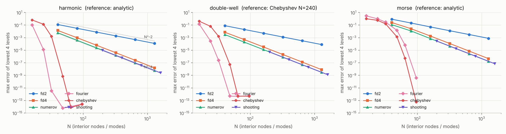
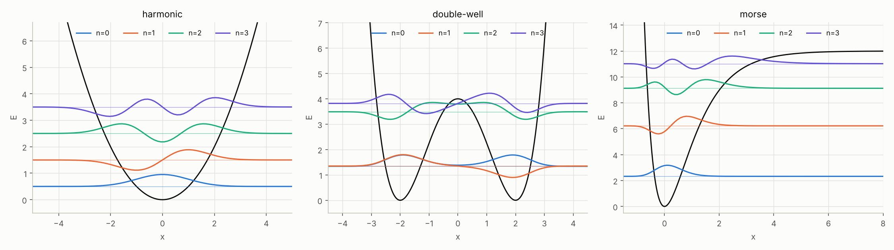
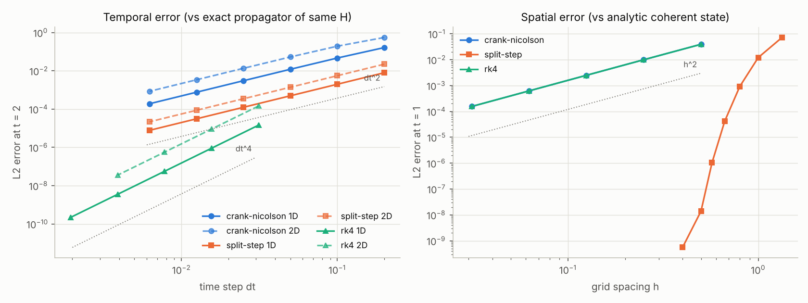
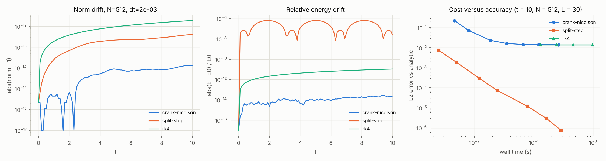
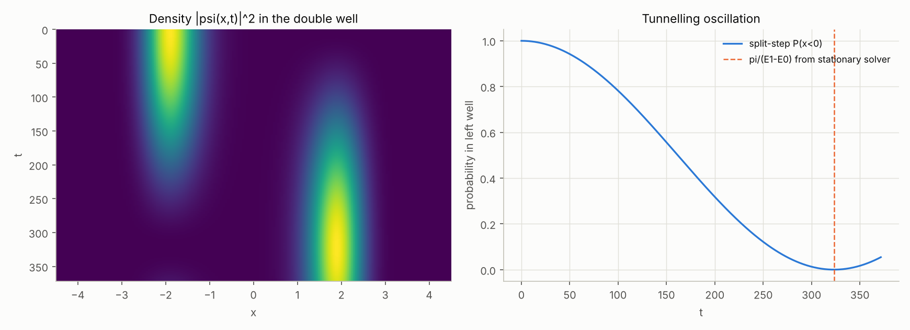
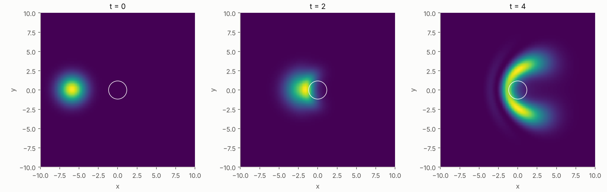
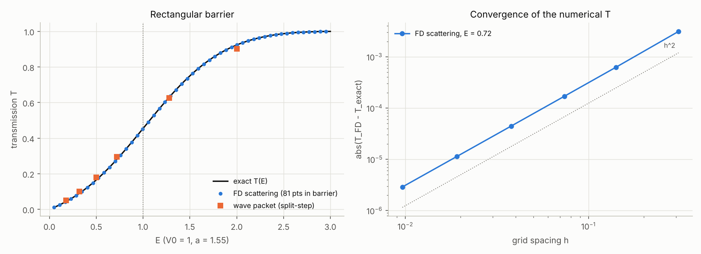
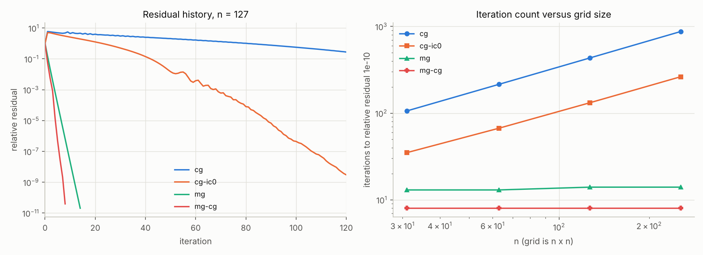
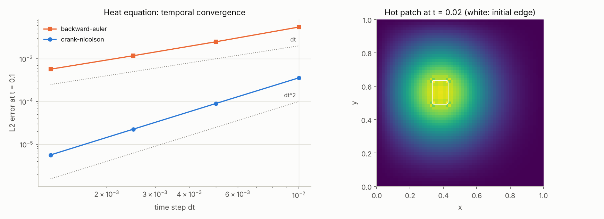

# pde-quantum-solvers

From-scratch numerical solvers for the Schrödinger equation and related PDEs, written to be
**compared against each other and against exact results**: accuracy, empirical order of
convergence, conservation of norm and energy, and cost.

Author: Georgii Baiev (physics student, CSUN; minors in Data Science and Mathematics) · 2026 · MIT license

Everything below (every table and every figure) was produced by running the code in this
repository (`pdeqs report`); nothing is typed in by hand. The numbers refer to the environment
listed in [Reproducing the results](#reproducing-the-results).

Units are `hbar = m = 1` throughout.

## What is implemented

| Problem | Methods (all implemented here; NumPy/SciPy supply only linear algebra and FFTs) |
|---|---|
| Stationary 1D Schrödinger, `-ψ''/2 + Vψ = Eψ` | 3-point finite differences (`fd2`), 5-point finite differences (`fd4`), matrix Numerov (`numerov`), Fourier collocation (`fourier`), Chebyshev collocation (`chebyshev`), shooting with Numerov integration and node-count bisection (`shooting`) |
| Time-dependent 1D/2D, `iψ_t = Hψ` | Crank–Nicolson (`crank-nicolson`), Strang split-step Fourier (`split-step`), classical RK4 on the finite-difference Hamiltonian (`rk4`) |
| Tunnelling through a rectangular barrier | stationary finite-difference scattering with transparent boundaries; wave-packet collision with the split-step solver; both versus the exact `T(E)` |
| 2D Poisson and heat equations (sparse) | direct sparse LU, CG, CG + Jacobi, CG + incomplete Cholesky (IC(0), written here), geometric multigrid V-cycle, multigrid-preconditioned CG; backward Euler / Crank–Nicolson heat solver |

Test potentials: harmonic oscillator and Morse potential (both with closed-form spectra) and a
double well (no closed form; compared with a converged Chebyshev reference).

All stationary solvers share one interface (`StationarySolver.solve(potential, x_min, x_max,
n_points, n_states)`), all propagators share another (`TimeDependentSolver.propagate(psi0,
t_final, n_steps)`), and the elliptic solvers are selected by name in `solve_poisson`.

## Install and use

```bash
pip install -e ".[dev]"
pdeqs list
pdeqs convergence crank-nicolson            # temporal and spatial order of Crank-Nicolson
pdeqs convergence numerov --potential morse
pdeqs eigen --potential harmonic --method chebyshev -n 80 --states 6
pdeqs evolve --dim 2 --t-final 5 --steps 1000
pdeqs tunneling --energy 0.72
pdeqs poisson --solver mg-cg -n 255
pdeqs report --out docs --readme README.md  # regenerate every figure and table below
```

`pdeqs convergence <method>` prints the error for a sequence of refinements, the observed
order between successive refinements, a least-squares fitted order, and writes a PNG
(`--no-plot` to skip, `--quick` for fewer refinements). Python API:

```python
from pdeqs.potentials import Morse
from pdeqs.stationary import SOLVERS

pot = Morse()
res = SOLVERS["numerov"].solve(pot, *pot.box, n_points=800, n_states=4)
print(res.energies - pot.exact_energies(4))
```

## Results

How errors are measured: *observed order* between two refinements is
`log(e_i/e_{i+1}) / log(s_i/s_{i+1})` for step size `s`; *fitted order* is the least-squares
slope of `log e` against `log s` over points above a 1e-11 round-off floor. For spectral
methods no algebraic order exists, so none is reported.

### 1. Stationary states



The error is the maximum over the four lowest levels. References: exact formulas for the
harmonic oscillator and the Morse potential, a Chebyshev solution with N = 240 for the double
well. "Time" is the wall time of one solve at the largest N in the row.

**Harmonic oscillator**

<!-- BEGIN:stationary_harmonic -->
| Method | Nominal order | Fitted order | Last-pair order | Error, smallest N | Error, largest N | Time, largest N (ms) |
|---|---|---|---|---|---|---|
| fd2 | 2 | 2.01 | 2.00 | 1.24e-01 (N=40) | 1.22e-04 (N=1280) | 3.3 |
| fd4 | 4 | 3.98 | 4.00 | 1.41e-02 (N=40) | 1.60e-08 (N=1280) | 463.2 |
| numerov | 4 | 4.01 | 4.00 | 5.98e-03 (N=40) | 5.99e-09 (N=1280) | 5004.6 |
| fourier | spectral | - | - | 1.00e-01 (N=16) | 2.66e-14 (N=96) | 28.7 |
| chebyshev | spectral | - | - | 6.47e-01 (N=16) | 2.49e-14 (N=96) | 47.1 |
| shooting | 4 | 4.00 | 4.00 | 9.90e-06 (N=200) | 2.45e-09 (N=1600) | 1102.7 |
<!-- END:stationary_harmonic -->

**Double well** (`V = 0.25 (x² − 4)²`)

<!-- BEGIN:stationary_double_well -->
| Method | Nominal order | Fitted order | Last-pair order | Error, smallest N | Error, largest N | Time, largest N (ms) |
|---|---|---|---|---|---|---|
| fd2 | 2 | 2.01 | 2.00 | 8.07e-02 (N=40) | 8.06e-05 (N=1280) | 2.1 |
| fd4 | 4 | 3.98 | 4.00 | 7.32e-03 (N=40) | 8.30e-09 (N=1280) | 1691.5 |
| numerov | 4 | 4.01 | 4.00 | 3.10e-03 (N=40) | 3.11e-09 (N=1280) | 549.3 |
| fourier | spectral | - | - | 1.41e-01 (N=16) | 5.42e-13 (N=96) | 1.0 |
| chebyshev | spectral | - | - | 4.16e-01 (N=16) | 4.81e-13 (N=96) | 5.7 |
| shooting | 4 | 4.00 | 4.00 | 5.14e-06 (N=200) | 1.28e-09 (N=1600) | 546.1 |
<!-- END:stationary_double_well -->

**Morse potential** (`D = 12`, `α = 1`, five bound states, four compared)

<!-- BEGIN:stationary_morse -->
| Method | Nominal order | Fitted order | Last-pair order | Error, smallest N | Error, largest N | Time, largest N (ms) |
|---|---|---|---|---|---|---|
| fd2 | 2 | 2.03 | 2.00 | 8.57e-01 (N=40) | 7.83e-04 (N=1280) | 2.3 |
| fd4 | 4 | 3.87 | 4.00 | 2.53e-01 (N=40) | 4.59e-07 (N=1280) | 390.6 |
| numerov | 4 | 3.94 | 4.00 | 1.15e-01 (N=40) | 1.72e-07 (N=1280) | 480.1 |
| fourier | spectral | - | - | 2.93e+00 (N=16) | 3.95e-10 (N=96) | 0.7 |
| chebyshev | spectral | - | - | 1.02e+00 (N=16) | 5.51e-14 (N=96) | 4.1 |
| shooting | 4 | 4.00 | 4.00 | 2.87e-04 (N=200) | 7.06e-08 (N=1600) | 528.7 |
<!-- END:stationary_morse -->

Eigenfunctions of the harmonic oscillator at N = 200 (pointwise maximum error against the exact
Hermite functions, after sign alignment):

<!-- BEGIN:stationary_wavefunctions -->
| Method | max error of psi_0 | max error of psi_3 | max energy error (6 levels) |
|---|---|---|---|
| fd2 | 1.87e-04 | 1.82e-03 | 1.21e-02 |
| fd4 | 7.52e-07 | 1.32e-05 | 9.61e-05 |
| numerov | 2.84e-07 | 5.00e-06 | 3.63e-05 |
| fourier | 2.27e-14 | 5.49e-12 | 5.11e-14 |
| chebyshev | 9.44e-15 | 5.45e-12 | 5.60e-14 |
| shooting | 2.84e-07 | 5.00e-06 | 3.63e-05 |
<!-- END:stationary_wavefunctions -->

Tunnel splitting of the lowest double-well doublet from every method:

<!-- BEGIN:double_well_splitting -->
| Method | N | E_0 | E_1 - E_0 (tunnel splitting) |
|---|---|---|---|
| fd2 | 400 | 1.33836049 | 9.717665e-03 |
| fd4 | 400 | 1.33855177 | 9.716344e-03 |
| numerov | 400 | 1.33855187 | 9.716348e-03 |
| shooting | 400 | 1.33855187 | 9.716348e-03 |
| fourier | 96 | 1.33855193 | 9.716350e-03 |
| chebyshev | 96 | 1.33855193 | 9.716350e-03 |
<!-- END:double_well_splitting -->



Notes. `shooting` solves the same discrete problem as the Numerov matrix (the Numerov recurrence
with a Dirichlet wall), so the two agree to the bisection tolerance on the same grid; shooting
only adds the cost of Python loops. The shooting node count relies on `h²(V_max − V_min) < 6`
(otherwise the Numerov coefficient changes sign); the solver warns when this is violated, which
is why its grid sizes start higher than the others. For the Morse potential the box has to be
wide enough that the *left wall* does not truncate the wave function: with the left wall at
x = -1.5 (instead of -2) the spectral methods stalled at about 1.5e-7, a box-truncation error
that no resolution can remove. This was observed while developing the examples; the committed
box is [-2, 18].

### 2. Time-dependent Schrödinger equation

Test problem: a Gaussian coherent state in the harmonic oscillator, whose exact evolution is
known analytically (it follows the classical orbit). Temporal errors are measured against the
*exact* propagator `exp(−iHt)` of each method's own spatial operator (dense eigendecomposition on
a deliberately small grid), so spatial error cannot contaminate them; spatial errors use the
analytic solution with a time step small enough not to matter.



<!-- BEGIN:timedep_orders -->
| Method | Nominal dt-order | 1D fitted | 1D last pair | 2D fitted | 2D last pair | h-order fitted (1D) | h-order last pair |
|---|---|---|---|---|---|---|---|
| crank-nicolson | 2 | 1.96 | 2.00 | 1.89 | 2.00 | 2.00 | 2.00 |
| split-step | 2 | 2.00 | 2.00 | 2.00 | 2.00 | spectral | - |
| rk4 | 4 | 4.00 | 4.00 | 4.00 | 4.00 | 2.00 | 2.00 |
<!-- END:timedep_orders -->

("2D" columns: a 20 × 20 grid, anisotropic oscillator; "1D": 64 points. For `rk4` the first
refinements must satisfy the stability limit, so its step sequence starts at smaller `dt`.)

#### Conservation of norm and energy, and cost

Same grid and time step for all methods (1D: N = 512, L = 30, `t = 10`; 2D: 96 × 96 grid, L = 16,
`t = 5`).

1D:

<!-- BEGIN:conservation_1d -->
| Method | dt | max abs(norm - 1) | max rel. energy drift | L2 error vs analytic | Time (s) |
|---|---|---|---|---|---|
| crank-nicolson | 2.0e-03 | 1.33e-14 | 2.74e-14 | 1.43e-02 | 0.178 |
| split-step | 2.0e-03 | 4.06e-13 | 6.43e-07 | 3.02e-06 | 0.195 |
| rk4 | 2.0e-03 | 1.91e-12 | 1.08e-11 | 1.42e-02 | 0.284 |
<!-- END:conservation_1d -->

2D:

<!-- BEGIN:conservation_2d -->
| Method | dt | max abs(norm - 1) | max rel. energy drift | L2 error vs analytic | Time (s) |
|---|---|---|---|---|---|
| crank-nicolson | 5.0e-03 | 5.33e-15 | 1.01e-14 | 1.05e-01 | 1.825 |
| split-step | 5.0e-03 | 2.84e-13 | 4.23e-06 | 2.75e-05 | 0.206 |
| rk4 | 5.0e-03 | 1.90e-09 | 8.09e-09 | 1.03e-01 | 0.609 |
<!-- END:conservation_2d -->



Crank–Nicolson with FD2 is limited by its *spatial* error on a fixed grid (the right panel
flattens at the spatial error level), whereas the split-step error keeps decreasing over the whole plotted range. This test problem is smooth and periodic-friendly, so it favours
spectral methods; it says nothing about potentials with discontinuities or boundaries.

RK4 is not unitary and conditionally stable. Stability demonstration (`rho(H)` is the spectral
radius of the finite-difference Hamiltonian; RK4 requires `dt · rho(H) < 2√2 ≈ 2.83`):

<!-- BEGIN:rk4_stability -->
| dt | dt x rho(H) | norm after t = 2 |
|---|---|---|
| 2.92e-03 | 2.00 | 1.000e+00 |
| 5.12e-03 | 3.50 | inf |
<!-- END:rk4_stability -->

#### Tunnelling oscillation in the double well (time-dependent versus stationary)

A packet prepared as the equal superposition of the two lowest states oscillates between the
wells with period `2π / (E₁ − E₀)`. The split-step solver reproduces the splitting obtained from
the *stationary* Fourier solver:

<!-- BEGIN:double_well_dynamics -->
| Quantity | Value |
|---|---|
| splitting E1-E0 from stationary Fourier solver | 9.716350e-03 |
| splitting from time-dependent first minimum (pi / t_min) | 9.716381e-03 |
| relative difference | 3.25e-06 |
| max abs(norm - 1) over the run | 3.07e-13 |
<!-- END:double_well_dynamics -->



#### 2D scattering off a Gaussian bump: split-step versus Crank–Nicolson



<!-- BEGIN:scattering_2d -->
| Quantity | Value |
|---|---|
| grid | 128 x 128, L = 24.0 |
| dt, steps | 0.01, 400 |
| transmitted probability (split-step) | 0.60777 |
| transmitted probability (Crank-Nicolson) | 0.58906 |
| relative L2 difference of the two wave functions | 1.18e-01 |
| same difference with the grid spacing doubled (half as many points) | 4.41e-01 |
| max abs(norm - 1): split-step / CN | 2.71e-14 / 2.22e-16 |
| wall time: split-step / CN (s) | 0.16 / 1.72 |
<!-- END:scattering_2d -->

Both propagators are unitary, but the two wave functions differ noticeably. The difference
shrinks when the grid is refined (compare the two rows above), consistent with the `O(h²)`
numerical dispersion of the three-/five-point finite-difference Laplacian, which the Fourier
method does not have. (The time step is the same in both rows; this attribution to spatial
dispersion is inferred from the scaling, not isolated by a separate experiment.)

### 3. Tunnelling through a barrier

Rectangular barrier, `V0 = 1`, width `a = 1.55` (snapped to an odd number of grid points so the
edges fall between points; the exact formula always uses the effective width). For `E < V0`

`T = 1 / (1 + V0² sinh²(κa) / (4E(V0 − E)))`, `κ = sqrt(2(V0 − E))`,

and `sin` replaces `sinh` above the barrier.



Finite-difference scattering at `E = 0.72` with exact lattice transparent boundary conditions
(`R + T = 1` to round-off, which also checks the flux bookkeeping):

<!-- BEGIN:tunneling_fd -->
| Points in barrier | h | T (FD) | T (exact) | abs error | order | abs(R + T - 1) |
|---|---|---|---|---|---|---|
| 5 | 3.10e-01 | 0.277414 | 0.280540 | 3.13e-03 | - | 4.4e-16 |
| 11 | 1.41e-01 | 0.279917 | 0.280540 | 6.23e-04 | 2.05 | 1.1e-15 |
| 21 | 7.38e-02 | 0.280371 | 0.280540 | 1.70e-04 | 2.01 | 1.3e-15 |
| 41 | 3.78e-02 | 0.280496 | 0.280540 | 4.45e-05 | 2.00 | 2.2e-15 |
| 81 | 1.91e-02 | 0.280529 | 0.280540 | 1.14e-05 | 2.00 | 8.9e-16 |
| 161 | 9.63e-03 | 0.280537 | 0.280540 | 2.88e-06 | 2.00 | 1.3e-15 |
<!-- END:tunneling_fd -->

Wave packets (`σ = 3`, centred at `x = −30`, split-step with `dt = 0.02`) cannot be compared with
`T(E_mean)`: the packet has a momentum spread, so the exact reference is `T` averaged over the
packet's Gaussian momentum distribution:

<!-- BEGIN:tunneling_packet -->
| k0 | mean energy k0^2/2 | T(mean energy) | T averaged over packet (exact) | T from split-step | abs difference |
|---|---|---|---|---|---|
| 0.60 | 0.180 | 0.04426 | 0.05107 | 0.05094 | 1.3e-04 |
| 0.80 | 0.320 | 0.09004 | 0.10021 | 0.10011 | 1.1e-04 |
| 1.00 | 0.500 | 0.16500 | 0.17887 | 0.17879 | 8.2e-05 |
| 1.20 | 0.720 | 0.28054 | 0.29560 | 0.29548 | 1.2e-04 |
| 1.60 | 1.280 | 0.63041 | 0.62534 | 0.62496 | 3.7e-04 |
| 2.00 | 2.000 | 0.92366 | 0.90329 | 0.90307 | 2.2e-04 |
<!-- END:tunneling_packet -->

### 4. Poisson and heat equations on the unit square

Model problem: `−Δu = f` on `(0,1)²` with `u = 0` on the boundary, five-point stencil, manufactured
solution `u = X(x)X(y)`, `X(s) = s(1−s)eˢ` (not a discrete eigenvector, so CG does real work).
Iterations are counted to a relative residual of 1e-10; "setup" (factorisations, hierarchy) is
included in the time.

<!-- BEGIN:poisson_iterations -->
| Solver | n = 31 | n = 63 | n = 127 | n = 255 |
|---|---|---|---|---|
| direct | 0.003 s (direct) | 0.010 s (direct) | 0.046 s (direct) | 0.310 s (direct) |
| cg | 106 it / 0.003 s | 215 it / 0.010 s | 434 it / 0.059 s | 874 it / 0.530 s |
| cg-jacobi | 106 it / 0.003 s | 215 it / 0.011 s | 434 it / 0.062 s | 874 it / 0.528 s |
| cg-ic0 | 35 it / 0.004 s | 67 it / 0.017 s | 132 it / 0.105 s | 263 it / 0.780 s |
| mg | 13 it / 0.009 s | 13 it / 0.012 s | 14 it / 0.024 s | 14 it / 0.075 s |
| mg-cg | 8 it / 0.006 s | 8 it / 0.015 s | 8 it / 0.016 s | 8 it / 0.055 s |
<!-- END:poisson_iterations -->

Discretisation error of the 5-point scheme (direct solve):

<!-- BEGIN:poisson_discretisation -->
| n | h | L2 error of the 5-point solution | observed order |
|---|---|---|---|
| 31 | 3.12e-02 | 4.75e-05 | - |
| 63 | 1.56e-02 | 1.19e-05 | 2.00 |
| 127 | 7.81e-03 | 2.97e-06 | 2.00 |
| 255 | 3.91e-03 | 7.42e-07 | 2.00 |
<!-- END:poisson_discretisation -->



Notes. Iteration counts are deterministic: plain CG grows linearly with `n` (it doubles when `n`
doubles), IC(0) cuts that by roughly a factor of three but not its growth, and multigrid
(stand-alone V-cycles, or as a CG preconditioner) is independent of `n`. Wall-clock times are
best-of-3 and depend on the machine: here the sparse direct solver wins at small `n` and
multigrid-preconditioned CG at the largest `n`, but with NumPy slicing overhead and a 2-core
machine this ranking should not be over-interpreted.

Jacobi preconditioning changes nothing for CG here because the stencil diagonal is
constant (the two rows coincide exactly; the test suite asserts it). Multigrid uses weighted
Jacobi smoothing (ω = 0.8, 2 pre- and 2 post-sweeps), full weighting, bilinear prolongation and
a direct solve on the 3 × 3 grid.

**Heat equation** `u_t = Δu`: the initial datum is a discrete eigenvector, so the exact
semi-discrete solution is known and only the temporal error is measured.

<!-- BEGIN:heat_orders -->
| Scheme | dt = 0.0100 | dt = 0.0050 | dt = 0.0025 | dt = 0.0013 | last-pair order |
|---|---|---|---|---|---|
| backward-euler | 5.49e-03 | 2.49e-03 | 1.18e-03 | 5.71e-04 | 1.05 |
| crank-nicolson | 3.57e-04 | 9.02e-05 | 2.26e-05 | 5.66e-06 | 2.00 |
<!-- END:heat_orders -->

Linear solvers inside the Crank–Nicolson time loop (63 × 63 grid, 20 steps, tolerance 1e-12):

<!-- BEGIN:heat_solvers -->
| Linear solver | inner iterations (20 steps) | wall time (s) | max difference to direct |
|---|---|---|---|
| direct | 1 solve per step | 0.201 | 0.00e+00 |
| cg | 973 | 0.053 | 1.89e-13 |
| cg-ic0 | 338 | 0.167 | 1.29e-13 |
| mg-cg | 160 | 0.181 | 5.57e-14 |
<!-- END:heat_solvers -->

The shifted operator `1/(θ dt) I − Δ_h` is much better conditioned than the pure Laplacian, so
plain CG needs only about 49 iterations per step here and is the fastest in wall-clock; multigrid
reduces the iteration count further but does not pay off at this size.



## Project layout

```
src/pdeqs/
  grid.py         uniform 1D/2D grids
  potentials.py   harmonic, double well, Morse, rectangular barrier (+ exact T(E))
  stationary.py   six eigenvalue solvers behind one interface
  timedep.py      Crank-Nicolson, split-step Fourier, RK4; coherent-state reference solutions
  tunneling.py    FD scattering and wave-packet transmission
  elliptic.py     Poisson/heat: CG, IC(0), multigrid, drivers
  convergence.py  empirical-order studies
  report.py       regenerates figures, tables, results.json and the README tables
  plotting.py     matplotlib style
  cli.py          `pdeqs` command
tests/            pytest suite
docs/figures/     PNGs used above      docs/results/  results.json, tables.md
```

## Tests, linting, CI

```bash
pytest -q          # unit and convergence tests
ruff check . && ruff format --check .
mypy src/pdeqs
```

The test suite checks, among other things: CN temporal order 2 (and spatial order 2); split-step
and CN norm conservation below 1e-10 over thousands of steps (1D and 2D); RK4 order 4 and its
instability above the stability limit; oscillator and Morse eigenvalues for every solver;
shooting ≡ Numerov on the same grid; analytic limits of `T(E)`; second-order convergence of the
scattering solver; grid-independent multigrid contraction; CG iteration growth; and CLI
behaviour. `.github/workflows/ci.yml` runs lint, type check and tests on Python 3.10–3.13. That
workflow file has not been executed on GitHub (no push was made); the commands it contains were
run locally.

## Limitations

- **These are educational solvers**, written for clarity and to study methods side by side. They
  are not optimised, not a substitute for production libraries, and have not been validated
  beyond the test problems shown.
- Python loops dominate the shooting solver; no JIT (Numba) is used, so its timings are not
  representative of a compiled implementation.
- Dense eigensolvers (`numerov`, `fourier`, `chebyshev`) scale as `O(N³)`; they are used for
  `N` up to a few thousand only.
- 1D stationary problems only; Dirichlet walls (Fourier: periodic). The time-dependent solvers
  assume a time-independent potential and a uniform grid.
- Time-dependent convergence is demonstrated mainly on a smooth Gaussian in a harmonic potential.
  Discontinuous potentials (the barrier) reduce observed accuracy; for the barrier the edge is
  placed between grid points deliberately to retain second-order behaviour.
- Multigrid works only on `n = 2^k − 1` grids, with a plain weighted-Jacobi smoother; the
  `ic0` preconditioner is specialised to the five-point matrix.
- Timings are single runs on a small 2-core machine and are indicative only (they vary from run
  to run); orders and errors are deterministic.
- No adaptive time stepping, no time-dependent potentials, no 3D.

## Reproducing the results

```bash
pip install -e ".[dev]"
pdeqs report --out docs --readme README.md   # about one minute
```

Environment of the committed results:

<!-- BEGIN:environment -->
Python 3.13.17, NumPy 2.5.3, SciPy 1.18.1, 2 CPU cores, Linux-6.18.44-fc-v165-x86_64-with-glibc2.39
<!-- END:environment -->

## License

MIT, see [LICENSE](LICENSE).

## Development note

Developed with AI assistance.
