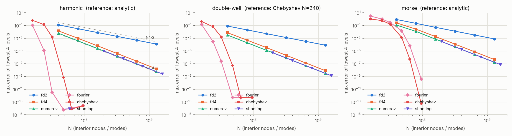
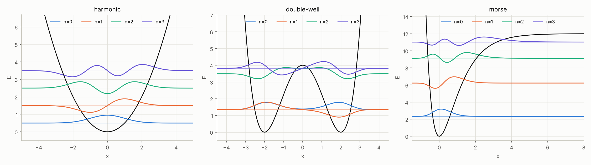
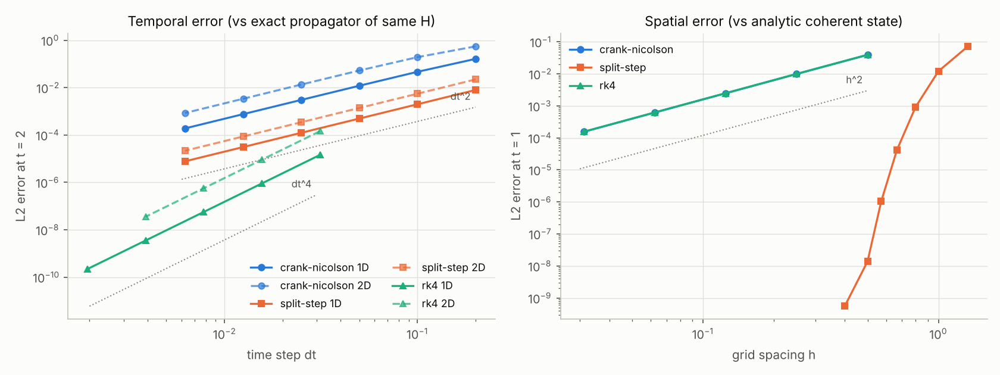
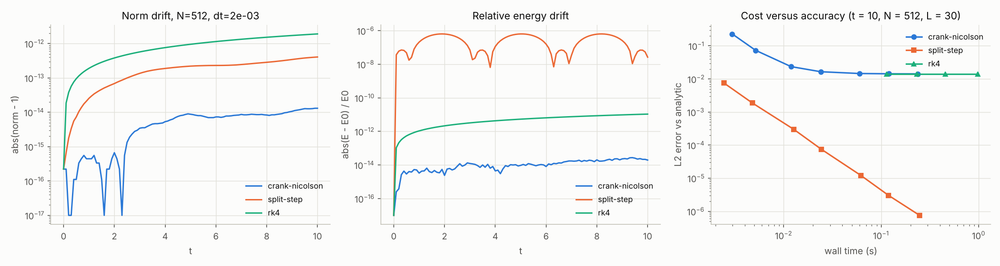
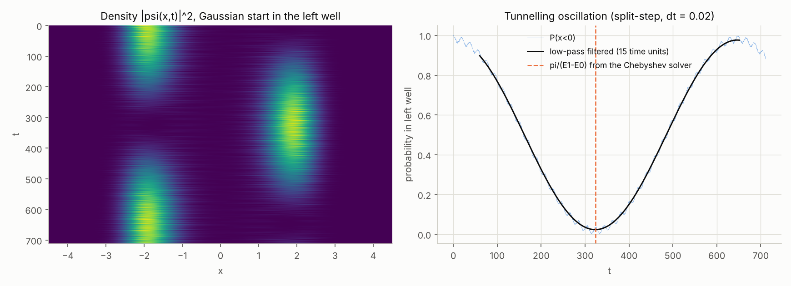
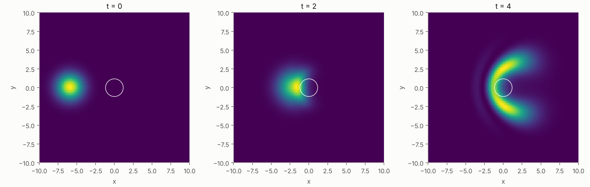
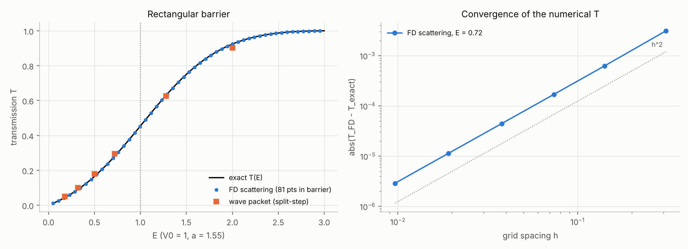
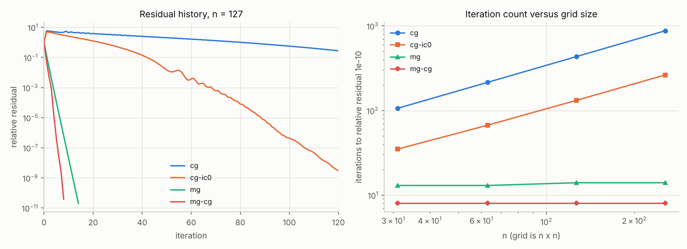
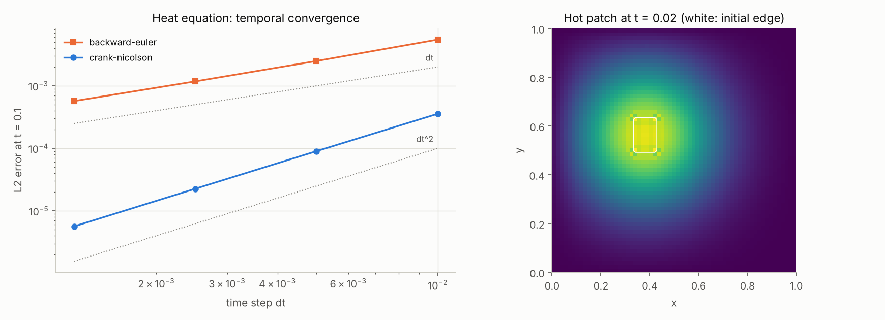

# schrodinger-bench

[](https://github.com/GodelKu/schrodinger-bench/actions/workflows/ci.yml)  

Numerical solvers for the Schrödinger equation and related PDEs, written from scratch so that
they can be compared with each other and with exact results. For each method I measure the
accuracy, the empirical order of convergence, the conservation of norm and energy, and the cost.

Every table and figure below comes from running `sbench report`. The tables are rendered from a
results file, and a test checks that the two match. The numbers refer to the environment listed
in [Reproducing the results](#reproducing-the-results). Version 0.2 fixes the problems found by
an independent automated review ([changelog](CHANGELOG.md)).

Author: Georgii Baiev, physics student. MIT license, see [LICENSE](LICENSE).
AI-assisted development.

## Install and use

```bash
pip install -e ".[dev]"
sbench list
sbench convergence crank-nicolson            # temporal and spatial order of Crank-Nicolson
sbench convergence numerov --potential morse
sbench eigen --potential harmonic --method chebyshev -n 80 --states 6
sbench evolve --dim 2 --t-final 5 --steps 1000
sbench tunneling --energy 0.72
sbench poisson --solver mg-cg -n 255
sbench report --out docs --readme README.md  # regenerate every figure and table below
```

`sbench convergence <method>` prints the error for a sequence of refinements, the observed
order between successive refinements and a least-squares fitted order, and writes a PNG
(`--no-plot` to skip, `--quick` for fewer refinements). The solvers can also be called from
Python:

```python
from schrodinger_bench.potentials import Morse
from schrodinger_bench.stationary import SOLVERS

pot = Morse()
res = SOLVERS["numerov"].solve(pot, *pot.box, n_points=800, n_states=4)
print(res.energies - pot.exact_energies(4))
```

## What is implemented

Units are `hbar = m = 1` throughout.

| Problem | Methods (all implemented here; NumPy/SciPy supply only linear algebra and FFTs) |
|---|---|
| Stationary 1D Schrödinger, `-ψ''/2 + Vψ = Eψ` | 3-point finite differences (`fd2`), 5-point finite differences (`fd4`), matrix Numerov (`numerov`), Fourier collocation (`fourier`), Chebyshev collocation (`chebyshev`), shooting with Numerov integration and node-count bisection (`shooting`) |
| Time-dependent 1D/2D, `iψ_t = Hψ` | Crank-Nicolson (`crank-nicolson`), Strang split-step Fourier (`split-step`), classical RK4 on the finite-difference Hamiltonian (`rk4`) |
| Tunnelling through a rectangular barrier | stationary finite-difference scattering with transparent boundaries; wave-packet collision with the split-step solver; both versus the exact `T(E)` |
| 2D Poisson and heat equations (sparse) | direct sparse LU, CG, CG + Jacobi, CG + incomplete Cholesky (IC(0), written here), geometric multigrid V-cycle, multigrid-preconditioned CG; backward Euler / Crank-Nicolson heat solver |

The test potentials are the harmonic oscillator and the Morse potential (both with closed-form
spectra) and a double well (no closed form; compared with a converged Chebyshev reference). Two
hard-wall problems test the boundary treatment, because their eigenfunctions have a non-zero
slope at the wall: the infinite square well (exact levels `n²π²/(2L²)`) and a linear ramp `V = x`
with a wall at `x = 0` (exact levels from the zeros of the Airy function).

All stationary solvers share one interface (`StationarySolver.solve(potential, x_min, x_max,
n_points, n_states)`), all propagators share another (`TimeDependentSolver.propagate(psi0,
t_final, n_steps)`), and the elliptic solvers are selected by name in `solve_poisson`.

## Main results

- The finite-difference, Numerov and shooting solvers reach their nominal orders on every test
  potential, and the Fourier and Chebyshev solvers converge spectrally.
- `fd4` stays fourth order at hard walls only with an odd extension of ψ beyond the wall. With a
  zero ghost value it is first order there.
- Crank-Nicolson and split-step conserve the norm to round-off. RK4 is stable only for
  `dt · rho(H) < 2√2`.
- A wave packet's transmission through a barrier has to be compared with `T` averaged over the
  packet's momentum distribution. `T(mean energy)` is off by far more.
- For the Poisson problem the multigrid iteration count does not grow with the grid, while plain
  CG needs twice the iterations when `n` doubles.

## Results

The observed order between two refinements is `log(e_i/e_{i+1}) / log(s_i/s_{i+1})` for step
size `s`. The fitted order is the least-squares slope of `log e` against `log s` over points
above a 1e-11 round-off floor. Spectral methods have no algebraic order, so none is reported.

Errors, orders and iteration counts are deterministic.

<!-- BEGIN:timing_note -->
Wall times are the median of 5 runs after one warm-up run, with the fastest and slowest of those runs in brackets.
<!-- END:timing_note -->

Wall times depend on the machine; compare them only within one table.

### 1. Stationary states



The error is the maximum over the four lowest levels. References: exact formulas for the
harmonic oscillator and the Morse potential, a Chebyshev solution with N = 240 for the double
well. "Time" is the wall time of one solve at the largest N in the row.

Harmonic oscillator:

<!-- BEGIN:stationary_harmonic -->
| Method | Nominal order | Fitted order | Last-pair order | Error, smallest N | Error, largest N | Time at largest N (ms) |
|---|---|---|---|---|---|---|
| fd2 | 2 | 2.01 | 2.00 | 1.24e-01 (N=40) | 1.22e-04 (N=1280) | 2.6 (2.4-2.7) |
| fd4 | 4 | 3.98 | 4.00 | 1.41e-02 (N=40) | 1.60e-08 (N=1280) | 409.7 (400.7-438.1) |
| numerov | 4 | 4.01 | 4.00 | 5.98e-03 (N=40) | 5.99e-09 (N=1280) | 485.9 (455.7-501.8) |
| fourier | spectral | - | - | 1.00e-01 (N=16) | 2.66e-14 (N=96) | 0.7 (0.6-0.8) |
| chebyshev | spectral | - | - | 6.47e-01 (N=16) | 2.49e-14 (N=96) | 3.3 (3.2-3.5) |
| shooting | 4 | 4.00 | 4.00 | 9.90e-06 (N=200) | 2.45e-09 (N=1600) | 553.3 (433.4-614.7) |
<!-- END:stationary_harmonic -->

Double well (`V = 0.25 (x² − 4)²`):

<!-- BEGIN:stationary_double_well -->
| Method | Nominal order | Fitted order | Last-pair order | Error, smallest N | Error, largest N | Time at largest N (ms) |
|---|---|---|---|---|---|---|
| fd2 | 2 | 2.01 | 2.00 | 8.07e-02 (N=40) | 8.06e-05 (N=1280) | 2.4 (2.3-2.5) |
| fd4 | 4 | 3.98 | 4.00 | 7.32e-03 (N=40) | 8.30e-09 (N=1280) | 381.9 (379.3-433.9) |
| numerov | 4 | 4.01 | 4.00 | 3.10e-03 (N=40) | 3.11e-09 (N=1280) | 489.9 (470.3-565.3) |
| fourier | spectral | - | - | 1.41e-01 (N=16) | 5.42e-13 (N=96) | 0.8 (0.7-2.9) |
| chebyshev | spectral | - | - | 4.16e-01 (N=16) | 4.81e-13 (N=96) | 3.5 (3.3-3.8) |
| shooting | 4 | 4.00 | 4.00 | 5.14e-06 (N=200) | 1.28e-09 (N=1600) | 499.8 (426.5-581.6) |
<!-- END:stationary_double_well -->

Morse potential (`D = 12`, `α = 1`, five bound states, four compared):

<!-- BEGIN:stationary_morse -->
| Method | Nominal order | Fitted order | Last-pair order | Error, smallest N | Error, largest N | Time at largest N (ms) |
|---|---|---|---|---|---|---|
| fd2 | 2 | 2.03 | 2.00 | 8.57e-01 (N=40) | 7.83e-04 (N=1280) | 2.8 (2.5-3.2) |
| fd4 | 4 | 3.87 | 4.00 | 2.53e-01 (N=40) | 4.59e-07 (N=1280) | 399.5 (376.6-470.8) |
| numerov | 4 | 3.94 | 4.00 | 1.15e-01 (N=40) | 1.72e-07 (N=1280) | 504.3 (458.1-526.5) |
| fourier | spectral | - | - | 2.93e+00 (N=16) | 3.95e-10 (N=96) | 0.6 (0.6-0.7) |
| chebyshev | spectral | - | - | 1.02e+00 (N=16) | 5.51e-14 (N=96) | 3.1 (3.0-3.2) |
| shooting | 4 | 4.00 | 4.00 | 2.87e-04 (N=200) | 7.06e-08 (N=1600) | 457.9 (428.7-547.0) |
<!-- END:stationary_morse -->

Both finite-difference matrices are banded, yet `fd4` is far slower than `fd2` at large N in the
tables above. The time goes into computing the eigenvectors. `scipy.linalg.eig_banded` (LAPACK's
banded symmetric driver) finds the eigenvalues quickly, but
to return eigenvectors it forms the N × N orthogonal matrix that reduces the band to tridiagonal
form, which grows roughly like N³. Timing the drivers on the harmonic-oscillator matrices:

<!-- BEGIN:fd4_cost -->
| N | fd2, tridiagonal driver, 4 eigenpairs (ms) | fd4, banded driver, 4 eigenvalues (ms) | fd4, banded driver, 4 eigenpairs (ms) |
|---|---|---|---|
| 320 | 0.6 (0.5-0.6) | 0.8 (0.8-0.8) | 2.8 (2.8-2.9) |
| 640 | 1.1 (1.1-1.1) | 2.2 (2.2-2.2) | 35.1 (30.7-35.2) |
| 1280 | 2.3 (2.2-2.3) | 8.9 (8.7-9.0) | 396.0 (363.3-409.3) |
<!-- END:fd4_cost -->

Inverse iteration with the banded matrix (or `scipy.sparse.linalg.eigsh` in shift-invert mode)
would avoid forming that matrix.

Hard walls: the infinite well on `[0, 1]` and the linear ramp `V = x` on `[0, 30]`, both with
exact levels and eigenfunctions that have a non-zero slope at the wall (`fourier` is periodic and
is left out; `chebyshev` is spectral, so no order is given):

<!-- BEGIN:hard_walls -->
| Problem | Method | Error, smallest N | Error, largest N | Last-pair order |
|---|---|---|---|---|
| infinite-well | fd2 | 6.47e-01 (N=39) | 1.01e-02 (N=319) | 2.00 |
| infinite-well | fd4 | 8.47e-03 (N=39) | 2.09e-06 (N=319) | 4.00 |
| infinite-well | numerov | 3.22e-03 (N=39) | 7.82e-07 (N=319) | 4.00 |
| infinite-well | shooting | 3.22e-03 (N=39) | 7.82e-07 (N=319) | 4.00 |
| infinite-well | chebyshev | 3.98e-01 (N=8) | 2.70e-13 (N=24) | spectral |
| linear-ramp | fd2 | 3.94e-02 (N=149) | 6.05e-04 (N=1199) | 2.00 |
| linear-ramp | fd4 | 1.53e-03 (N=149) | 3.86e-07 (N=1199) | 4.00 |
| linear-ramp | numerov | 5.83e-04 (N=149) | 1.41e-07 (N=1199) | 4.00 |
| linear-ramp | shooting | 5.83e-04 (N=149) | 1.41e-07 (N=1199) | 4.00 |
| linear-ramp | chebyshev | 3.53e-04 (N=32) | 1.92e-13 (N=96) | spectral |
<!-- END:hard_walls -->

The five-point stencil of `fd4` needs ψ one node outside the box next to each wall. The solver
uses the odd extension `ψ(x_wall − h) = −ψ(x_wall + h)`, which is consistent with `ψ = 0` and
`ψ'' = 2(V − E)ψ = 0` at the wall and keeps the method fourth order at hard walls. A zero ghost
value makes it first order there; the three potentials above cannot show the difference, because
their states vanish long before the walls.

Eigenfunctions of the harmonic oscillator at N = 200 (pointwise maximum error against the exact
Hermite functions, after sign alignment):

<!-- BEGIN:stationary_wavefunctions -->
| Method | max error of psi_0 | max error of psi_3 | max energy error (6 levels) |
|---|---|---|---|
| fd2 | 1.87e-04 | 1.82e-03 | 1.21e-02 |
| fd4 | 7.52e-07 | 1.32e-05 | 9.61e-05 |
| numerov | 2.84e-07 | 5.00e-06 | 3.63e-05 |
| fourier | 2.27e-14 | 5.49e-12 | 5.11e-14 |
| chebyshev | 9.44e-15 | 5.45e-12 | 5.60e-14 |
| shooting | 2.84e-07 | 5.00e-06 | 3.63e-05 |
<!-- END:stationary_wavefunctions -->

Tunnel splitting of the lowest double-well doublet from every method:

<!-- BEGIN:double_well_splitting -->
| Method | N | E_0 | E_1 - E_0 (tunnel splitting) |
|---|---|---|---|
| fd2 | 400 | 1.33836049 | 9.717665e-03 |
| fd4 | 400 | 1.33855177 | 9.716344e-03 |
| numerov | 400 | 1.33855187 | 9.716348e-03 |
| shooting | 400 | 1.33855187 | 9.716348e-03 |
| fourier | 96 | 1.33855193 | 9.716350e-03 |
| chebyshev | 96 | 1.33855193 | 9.716350e-03 |
<!-- END:double_well_splitting -->



`shooting` solves the same discrete problem as the Numerov matrix (the Numerov recurrence
with a Dirichlet wall), so the two agree to the bisection tolerance on the same grid; shooting
only adds the cost of Python loops. The shooting node count relies on `h²(V_max − V_min) < 6`
(otherwise the Numerov coefficient changes sign); the solver warns when this is violated, which
is why its grid sizes start higher than the others. For the Morse potential the box has to be
wide enough that the left wall does not truncate the wave function. Moving the wall closer
leaves an error that no resolution can remove:

<!-- BEGIN:morse_box -->
| Box | Chebyshev error, N = 96 | Chebyshev error, N = 192 |
|---|---|---|
| [-2, 18] | 5.51e-14 | 1.42e-14 |
| [-1.5, 18] | 1.55e-07 | 1.55e-07 |
<!-- END:morse_box -->

### 2. Time-dependent Schrödinger equation

Test problem: a Gaussian coherent state in the harmonic oscillator, whose exact evolution is
known analytically (it follows the classical orbit). Temporal errors are measured against the
exact propagator `exp(−iHt)` of each method's own spatial operator (dense eigendecomposition on
a deliberately small grid), so spatial error cannot contaminate them; spatial errors use the
analytic solution with a time step small enough not to matter.



<!-- BEGIN:timedep_orders -->
| Method | Nominal dt-order | 1D fitted | 1D last pair | 2D fitted | 2D last pair | h-order fitted (1D) | h-order last pair |
|---|---|---|---|---|---|---|---|
| crank-nicolson | 2 | 1.96 | 2.00 | 1.89 | 2.00 | 2.00 | 2.00 |
| split-step | 2 | 2.00 | 2.00 | 2.00 | 2.00 | spectral | - |
| rk4 | 4 | 4.00 | 4.00 | 4.00 | 4.00 | 2.00 | 2.00 |
<!-- END:timedep_orders -->

The 2D columns use a 20 × 20 grid and an anisotropic oscillator, the 1D columns 64 points. For
`rk4` the first refinements must satisfy the stability limit, so its step sequence starts at
smaller `dt`.

#### Conservation of norm and energy, and cost

Same grid and time step for all methods (1D: N = 512, L = 30, `t = 10`; 2D: 96 × 96 grid, L = 16,
`t = 5`).

1D:

<!-- BEGIN:conservation_1d -->
| Method | dt | max abs(norm(t) - norm(0)) | max rel. energy drift | L2 error vs analytic | Time (s) |
|---|---|---|---|---|---|
| crank-nicolson | 2.0e-03 | 1.33e-14 | 2.74e-14 | 1.43e-02 | 0.151 (0.124-0.180) |
| split-step | 2.0e-03 | 4.06e-13 | 6.43e-07 | 3.02e-06 | 0.154 (0.131-0.171) |
| rk4 | 2.0e-03 | 1.91e-12 | 1.08e-11 | 1.42e-02 | 0.291 (0.262-0.371) |
<!-- END:conservation_1d -->

2D:

<!-- BEGIN:conservation_2d -->
| Method | dt | max abs(norm(t) - norm(0)) | max rel. energy drift | L2 error vs analytic | Time (s) |
|---|---|---|---|---|---|
| crank-nicolson | 5.0e-03 | 5.33e-15 | 1.01e-14 | 1.05e-01 | 2.181 (1.926-2.300) |
| split-step | 5.0e-03 | 2.84e-13 | 4.23e-06 | 2.75e-05 | 0.260 (0.226-0.316) |
| rk4 | 5.0e-03 | 1.90e-09 | 8.09e-09 | 1.03e-01 | 0.604 (0.591-0.629) |
<!-- END:conservation_2d -->



Crank-Nicolson with FD2 is limited by its spatial error on a fixed grid (the right panel
flattens at the spatial error level), whereas the split-step error keeps decreasing over the
whole plotted range. This test problem is smooth and periodic-friendly, so it favours spectral
methods; it says nothing about potentials with discontinuities or boundaries.

RK4 is not unitary and conditionally stable. On the imaginary axis its stability function
`R(w) = 1 + w + w²/2 + w³/6 + w⁴/24` satisfies `|R(−iz)| ≤ 1` exactly for `z ≤ 2√2 ≈ 2.83`, so
the step must satisfy `dt · rho(H) < 2√2`, with `rho(H)` the spectral radius of the
finite-difference Hamiltonian. Steps on both sides of the limit (round-off seeds the top
eigenmode, which then grows by the factor in the third column at every step):

<!-- BEGIN:rk4_stability -->
| dt | dt x rho(H) | growth per step of the top mode, abs(R(-i dt rho)) | norm after t = 20 |
|---|---|---|---|
| 2.921e-03 | 2.000 | 0.745 | 1.000e+00 |
| 4.089e-03 | 2.800 | 0.931 | 1.000e+00 |
| 4.176e-03 | 2.860 | 1.081 | 3.939e+121 |
| 5.111e-03 | 3.500 | 3.816 | inf |
<!-- END:rk4_stability -->

#### Tunnelling oscillation in the double well (time-dependent versus stationary)

A Gaussian placed in the left well, with the width of the local harmonic ground state and built
without any eigensolver, is mostly a superposition of the lowest doublet, so its probability
`P(x < 0, t)` oscillates between the wells with angular frequency `E₁ − E₀`. The split-step run
(256 Fourier points) is compared with the splitting from the Chebyshev stationary solver, a
different basis and method. The fast oscillations inside each well are removed with a Gaussian
low-pass filter, and `a + b cos(ωt) + c sin(ωt)` is fitted to the filtered signal over 1.1
periods. As a control, the last columns give the splitting of the one-step Strang propagator
itself, from the eigenphases of its 256 × 256 matrix:

<!-- BEGIN:double_well_dynamics -->
Reference E1 - E0 (chebyshev, N = 200): 9.716349909e-03

| dt | E1 - E0 from the fit of P(x < 0, t) | relative difference | order | E1 - E0 of the Strang step (eigenphases) | relative difference | max abs(norm(t) - norm(0)) |
|---|---|---|---|---|---|---|
| 0.04 | 9.724052849e-03 | 7.93e-04 | - | 9.724053026e-03 | 7.93e-04 | 6.01e-13 |
| 0.02 | 9.718268974e-03 | 1.98e-04 | 2.01 | 9.718269126e-03 | 1.98e-04 | 6.86e-13 |
| 0.01 | 9.716829157e-03 | 4.93e-05 | 2.00 | 9.716829304e-03 | 4.93e-05 | 1.40e-13 |
<!-- END:double_well_dynamics -->



The fit reproduces the propagator's own splitting, and both differ from the stationary value by
a relative amount that falls as `dt²`, so the remaining difference is the splitting error of the
Strang scheme. Version 0.1 measured this differently, and its close agreement turned out to be
accidental; see the [changelog](CHANGELOG.md).

#### 2D scattering off a Gaussian bump: split-step versus Crank-Nicolson



<!-- BEGIN:scattering_2d -->
| Quantity | Value |
|---|---|
| grid | 128 x 128, L = 24.0 |
| dt, steps | 0.01, 400 |
| transmitted probability (split-step) | 0.60777 |
| transmitted probability (Crank-Nicolson) | 0.58906 |
| relative L2 difference of the two wave functions | 1.18e-01 |
| same difference with the grid spacing doubled (half as many points) | 4.41e-01 |
| max abs(norm(t) - norm(0)): split-step / CN | 2.71e-14 / 2.22e-16 |
| wall time, split-step (s) | 0.23 (0.20-0.26) |
| wall time, Crank-Nicolson (s) | 1.72 (1.52-2.29) |
<!-- END:scattering_2d -->

Both propagators are unitary, but the two wave functions differ noticeably. The difference
shrinks when the grid is refined (compare the two rows above), consistent with the `O(h²)`
numerical dispersion of the three-/five-point finite-difference Laplacian, which the Fourier
method does not have. The time step is the same in both rows; I infer the attribution to spatial
dispersion from the scaling and have not isolated it by a separate experiment.

### 3. Tunnelling through a barrier

Rectangular barrier, `V0 = 1`, width `a = 1.55` (snapped to an odd number of grid points so the
edges fall between points; the exact formula always uses the effective width). For `E < V0`

`T = 1 / (1 + V0² sinh²(κa) / (4E(V0 − E)))`, `κ = sqrt(2(V0 − E))`,

and `sin` replaces `sinh` above the barrier.



Finite-difference scattering at `E = 0.72` with exact lattice transparent boundary conditions
(`R + T = 1` to round-off, which also checks the flux bookkeeping):

<!-- BEGIN:tunneling_fd -->
| Points in barrier | h | T (FD) | T (exact) | abs error | order | abs(R + T - 1) |
|---|---|---|---|---|---|---|
| 5 | 3.10e-01 | 0.277414 | 0.280540 | 3.13e-03 | - | 4.4e-16 |
| 11 | 1.41e-01 | 0.279917 | 0.280540 | 6.23e-04 | 2.05 | 1.1e-15 |
| 21 | 7.38e-02 | 0.280371 | 0.280540 | 1.70e-04 | 2.01 | 1.3e-15 |
| 41 | 3.78e-02 | 0.280496 | 0.280540 | 4.45e-05 | 2.00 | 2.2e-15 |
| 81 | 1.91e-02 | 0.280529 | 0.280540 | 1.14e-05 | 2.00 | 8.9e-16 |
| 161 | 9.63e-03 | 0.280537 | 0.280540 | 2.88e-06 | 2.00 | 1.3e-15 |
<!-- END:tunneling_fd -->

Wave packets (`σ = 3`, centred at `x = −30`, split-step with `dt = 0.02`) cannot be compared with
`T(E_mean)`: the packet has a momentum spread, so the exact reference is `T` averaged over the
packet's Gaussian momentum distribution:

<!-- BEGIN:tunneling_packet -->
| k0 | mean energy k0^2/2 | T(mean energy) | T averaged over packet (exact) | T from split-step | split-step minus averaged exact |
|---|---|---|---|---|---|
| 0.60 | 0.180 | 0.04426 | 0.05107 | 0.05094 | -1.3e-04 |
| 0.80 | 0.320 | 0.09004 | 0.10021 | 0.10011 | -1.1e-04 |
| 1.00 | 0.500 | 0.16500 | 0.17887 | 0.17879 | -8.2e-05 |
| 1.20 | 0.720 | 0.28054 | 0.29560 | 0.29548 | -1.2e-04 |
| 1.60 | 1.280 | 0.63041 | 0.62534 | 0.62496 | -3.7e-04 |
| 2.00 | 2.000 | 0.92366 | 0.90329 | 0.90307 | -2.2e-04 |
<!-- END:tunneling_packet -->

The last column is not a converged numerical error. `T` is read when the packet centre has
travelled as far beyond the barrier as it started before it (`t1 = 2·30/k0`), when the slowest
momentum components are still arriving. Read later, on a box four times longer with the same
grid spacing, the difference changes size and even sign:

<!-- BEGIN:tunneling_packet_later -->
| k0 | box length | h | difference at 1 t1 | difference at 2 t1 | difference at 3 t1 |
|---|---|---|---|---|---|
| 0.60 | 800 | 0.05 | -1.6e-04 | +1.6e-04 | +1.7e-04 |
| 1.20 | 800 | 0.05 | +2.2e-05 | -4.6e-05 | -1.7e-05 |
<!-- END:tunneling_packet_later -->

Its source has not been isolated (measurement time, box length, the sharp barrier on the grid),
so the table supports agreement within the size of these differences and no more. It does show
that the momentum-averaged `T` is the right reference: `T(mean energy)` is off by far more.

### 4. Poisson and heat equations on the unit square

Model problem: `−Δu = f` on `(0,1)²` with `u = 0` on the boundary, five-point stencil, manufactured
solution `u = X(x)X(y)`, `X(s) = s(1−s)eˢ` (not a discrete eigenvector, so CG does real work).
Iterations are counted to a relative residual of 1e-10:

<!-- BEGIN:poisson_iterations -->
| Solver | n = 31 | n = 63 | n = 127 | n = 255 |
|---|---|---|---|---|
| cg | 106 | 215 | 434 | 874 |
| cg-jacobi | 106 | 215 | 434 | 874 |
| cg-ic0 | 35 | 67 | 132 | 263 |
| mg | 13 | 13 | 14 | 14 |
| mg-cg | 8 | 8 | 8 | 8 |
<!-- END:poisson_iterations -->

Wall time of one solve, including the setup (factorisations, multigrid hierarchy):

<!-- BEGIN:poisson_times -->
| Solver | n = 31 (s) | n = 63 (s) | n = 127 (s) | n = 255 (s) |
|---|---|---|---|---|
| direct | 0.005 (0.005-0.006) | 0.015 (0.013-0.016) | 0.048 (0.047-0.048) | 0.316 (0.298-0.397) |
| cg | 0.004 (0.003-0.005) | 0.016 (0.015-0.016) | 0.065 (0.060-0.080) | 0.538 (0.517-0.591) |
| cg-jacobi | 0.004 (0.003-0.005) | 0.011 (0.011-0.013) | 0.078 (0.076-0.083) | 0.604 (0.565-0.624) |
| cg-ic0 | 0.006 (0.006-0.007) | 0.017 (0.016-0.017) | 0.105 (0.104-0.167) | 0.811 (0.778-0.952) |
| mg | 0.013 (0.010-0.013) | 0.012 (0.012-0.013) | 0.026 (0.024-0.027) | 0.079 (0.073-0.095) |
| mg-cg | 0.010 (0.009-0.010) | 0.009 (0.009-0.010) | 0.023 (0.019-0.025) | 0.063 (0.059-0.065) |

Fastest median in this run: n = 31: cg-jacobi, n = 63: mg-cg, n = 127: mg-cg, n = 255: mg-cg.
<!-- END:poisson_times -->

Discretisation error of the 5-point scheme (direct solve):

<!-- BEGIN:poisson_discretisation -->
| n | h | L2 error of the 5-point solution | observed order |
|---|---|---|---|
| 31 | 3.12e-02 | 4.75e-05 | - |
| 63 | 1.56e-02 | 1.19e-05 | 2.00 |
| 127 | 7.81e-03 | 2.97e-06 | 2.00 |
| 255 | 3.91e-03 | 7.42e-07 | 2.00 |
<!-- END:poisson_discretisation -->



Plain CG needs twice the iterations when `n` doubles (the condition number grows like
`n²`), IC(0) lowers the count by a constant factor but not its growth, and multigrid
(stand-alone V-cycles, or as a CG preconditioner) is independent of `n`. A V-cycle is a sequence
of NumPy operations on small arrays, so its overhead per iteration is large on small grids; the
direct solver's fill-in grows with `n`. The fastest solver per grid size is printed from the run
under the timing table.

Jacobi preconditioning changes nothing for CG here because the stencil diagonal is
constant (the two rows coincide exactly; the test suite asserts it). Multigrid uses weighted
Jacobi smoothing (ω = 0.8, 2 pre- and 2 post-sweeps), full weighting, bilinear prolongation and
a direct solve on the 3 × 3 grid.

Heat equation `u_t = Δu`: the initial datum is a discrete eigenvector, so the exact
semi-discrete solution is known and only the temporal error is measured.

<!-- BEGIN:heat_orders -->
| Scheme | dt = 0.0100 | dt = 0.0050 | dt = 0.0025 | dt = 0.0013 | last-pair order |
|---|---|---|---|---|---|
| backward-euler | 5.49e-03 | 2.49e-03 | 1.18e-03 | 5.71e-04 | 1.05 |
| crank-nicolson | 3.57e-04 | 9.02e-05 | 2.26e-05 | 5.66e-06 | 2.00 |
<!-- END:heat_orders -->

Linear solvers inside the Crank-Nicolson time loop (63 × 63 grid, 20 steps, tolerance 1e-12).
The matrix `I/(θ dt) − Δ_h` is the same at every step, so each solver is set up once (sparse LU
factors, IC(0) factor or multigrid hierarchy) and reused for all right-hand sides; the total
includes that setup:

<!-- BEGIN:heat_solvers -->
| Linear solver | iterations per step | one-time setup (s) | total, 20 steps incl. setup (s) | max difference to direct |
|---|---|---|---|---|
| direct | 1 LU solve | 0.010 (0.010-0.010) | 0.021 (0.020-0.023) | 0.00e+00 |
| cg | 48.6 | 0.000 (0.000-0.000) | 0.054 (0.050-0.063) | 1.89e-13 |
| cg-ic0 | 16.9 | 0.006 (0.005-0.008) | 0.084 (0.067-0.096) | 1.29e-13 |
| mg-cg | 8.0 | 0.001 (0.001-0.001) | 0.146 (0.144-0.156) | 5.57e-14 |

Fastest to slowest median in this run: direct, cg, cg-ic0, mg-cg.
<!-- END:heat_solvers -->

After the one-time factorisation, a direct step is one forward and one back substitution with
the sparse LU factors. A CG iteration costs one matrix-vector product, plus two triangular solves
with IC(0) or one V-cycle with multigrid. The shifted operator is much better conditioned than
the pure Laplacian, so even plain CG needs few iterations per step; the preconditioners reduce
the count further, but each of their iterations costs more. Which option wins depends on the grid
size and the machine, so the ranking above is printed from the run.



## Project layout

```
src/sbench/
  grid.py         uniform 1D/2D grids
  potentials.py   harmonic, double well, Morse, infinite well, linear ramp, barrier (+ exact T(E))
  stationary.py   six eigenvalue solvers behind one interface
  timedep.py      Crank-Nicolson, split-step Fourier, RK4; coherent-state reference solutions
  tunneling.py    FD scattering and wave-packet transmission
  elliptic.py     Poisson/heat: CG, IC(0), multigrid, drivers
  convergence.py  empirical-order studies
  report.py       runs every study; writes figures and results.json
  tables.py       renders the README tables from results.json
  timing.py       repeated wall-time measurements (median and range)
  plotting.py     matplotlib style
  cli.py          `sbench` command
tests/            pytest suite (test_readme_sync.py: README = rendered JSON;
                  test_roadmap.py: known answers of the planned extensions)
tools/            fill_readme.py
docs/figures/     PNGs used above      docs/results/  results.json, tables.md
docs/ROADMAP.md   planned extensions   CHANGELOG.md   what changed after the review
```

## Tests, linting, CI

```bash
pytest -q          # unit, convergence, README-sync and roadmap tests
ruff check . && ruff format --check .
mypy src
```

The test suite checks, among other things: CN temporal order 2 (and spatial order 2); split-step
and CN norm conservation below 1e-10 over 4000 steps in 1D and 400 in 2D; RK4 order 4 and the
stability limit bracketed at `dt · rho(H)` = 2.80 and 2.86; oscillator and Morse eigenvalues
for every solver; the order of every Dirichlet solver on the infinite well and on a linear ramp;
shooting ≡ Numerov on the same grid; analytic limits of `T(E)`; second-order convergence of the
scattering solver; grid-independent multigrid contraction; CG iteration growth and pinned
iteration counts; `L Lᵀ = A` on the sparsity pattern for the IC(0) factor, and its application
as plain triangular substitution; zero right-hand sides; Crank-Nicolson's undershoot on
discontinuous heat data; that the README tables equal the results file; and CLI behaviour,
including clear errors for invalid arguments. `tests/test_roadmap.py` holds the known-answer
tests of the [roadmap](docs/ROADMAP.md), marked as expected failures.

`.github/workflows/ci.yml` runs ruff, mypy and pytest on Linux, macOS and Windows with Python
3.10 to 3.13; the badge at the top shows its status.

## Limitations

- These are educational solvers, written for clarity and to study methods side by side. They
  are not optimised, not a substitute for production libraries, and have not been validated
  beyond the test problems shown.
- Python loops dominate the shooting solver; no JIT (Numba) is used, so its timings are not
  representative of a compiled implementation.
- Dense eigensolvers (`numerov`, `fourier`, `chebyshev`) scale as `O(N³)`; they are used for
  `N` up to a few thousand only.
- 1D stationary problems only; Dirichlet walls. The Fourier solver is periodic, so it does not
  model hard walls: on the infinite well it returns the spectrum of a periodic box. The
  time-dependent solvers assume a time-independent potential and a uniform grid.
- Time-dependent convergence is demonstrated mainly on a smooth Gaussian in a harmonic potential.
  Discontinuous potentials (the barrier) reduce observed accuracy; for the barrier the edge is
  placed between grid points deliberately to retain second-order behaviour.
- Multigrid works only on `n = 2^k − 1` grids, with a plain weighted-Jacobi smoother; the
  `ic0` preconditioner is specialised to the five-point matrix.
- Crank-Nicolson for the heat equation is A-stable but not L-stable. On the discontinuous hot
  patch the stiffest modes change sign at every step, so the first step undershoots below zero
  (the test suite asserts this) before the oscillation is damped; the figure at `t = 0.02` is
  past that. Backward Euler stays non-negative. A start with backward-Euler half-steps
  (Rannacher) is item 5 of the [roadmap](docs/ROADMAP.md).
- There is no explicit heat scheme, so the `dt ≤ h²/4` stability limit of forward Euler is not
  demonstrated; the explicit-scheme limit shown is RK4's for the Schrödinger equation.
- Wall times are medians of repeated runs on one machine and are indicative only; errors,
  orders and iteration counts are deterministic.
- No adaptive time stepping, no time-dependent potentials, no 3D.

## Reproducing the results

```bash
pip install -e ".[dev]"
sbench report --out docs --readme README.md   # all studies, a few minutes
python tools/fill_readme.py                  # README tables from docs/results/results.json only
```

Every table in this README is rendered from `docs/results/results.json` by `schrodinger_bench.tables`;
`tests/test_readme_sync.py` fails if the README, `docs/results/tables.md` and the JSON disagree,
and recomputes a few of the numbers from the code.

Environment of the committed results:

<!-- BEGIN:environment -->
Python 3.13.17, NumPy 2.5.3, SciPy 1.18.1, Linux
<!-- END:environment -->

## Documentation

- [CHANGELOG.md](CHANGELOG.md): what the independent automated review found and what version 0.2 changed.
- [docs/ROADMAP.md](docs/ROADMAP.md): planned extensions, each with a failing test that defines
  done.

## Development

I chose the problems and the rules for checking the solvers. An independent automated review of version
0.1 re-ran the report, reproduced the claims with its own scripts and injected bugs to see
whether the tests catch them. It found the problems listed in the [changelog](CHANGELOG.md):
`fd4` was first order at hard walls, the heat-equation benchmark refactorised a constant matrix
at every step, one validation was not independent, and the timings were single runs. Version 0.2
fixes them. The roadmap items are mine to implement.

These are the rules I set:

* every solver is compared with an exact result (oscillator, Morse, infinite well, Airy levels,
  rectangular-barrier `T(E)`, coherent states) or with an independent method;
* orders are measured on refinements where `h` or `dt` halves exactly, and temporal errors are
  measured against the exact propagator of the same spatial operator;
* the tests are checked by injecting bugs: each injected bug must make at least one test fail;
* every table in this README is rendered from `docs/results/results.json`, and a test fails if
  the README and the JSON disagree;
* wall times are medians of repeated runs, and rankings that depend on them are printed from the
  run.
